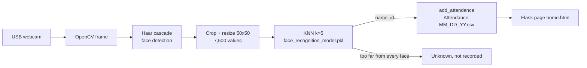

# Face Recognition Attendance System on Raspberry Pi

[](https://github.com/amine-belkacem/face-attendance-raspberry-pi/actions/workflows/ci.yml)

A time clock that recognises people with a USB webcam and records their arrival time in a daily CSV file. It runs on a Raspberry Pi 3 B+ with Python, OpenCV (Haar cascade) for face detection, a k-nearest-neighbours classifier for recognition and a small Flask web page to enrol users and see who is in.

## Project context

I built this on my own during my first M2 (Embedded Electronic Systems) at USTHB, Algiers. The brief was to design an attendance system for employees on an embedded board, from choosing the hardware to a working demo. I handled the whole thing: Raspberry Pi setup, wiring, the Python application and the web interface.

The Flask/KNN application started from a widely shared open-source tutorial ("Face Recognition Based Attendance System"). My work was to port it to the Raspberry Pi, integrate the hardware, add the handling of unknown faces and, while preparing this repository, fix the bugs listed below.

## Why a Raspberry Pi and a KNN?

I wanted the whole system to run on one cheap board next to the door, without sending face images to a server. That rules out heavy deep-learning models on a Pi 3 B+ with 1 GB of RAM.

So I kept the pipeline as light as possible:

- **Haar cascade** for detection: it is shipped with OpenCV, is cheap enough for the Pi's CPU and needs no training.
- **KNN on raw pixels** for recognition: each face is resized to 50×50 in colour, which gives a vector of 7,500 values. Enrolling a new person only means storing 50 images and refitting the model. There is no neural network to train.

The price of that simplicity is accuracy and robustness to lighting, which I come back to in the limitations.



| Part | File / function | Role |
|---|---|---|
| Web app | `app.py` (Flask routes `/`, `/start`, `/add`) | Shows today's attendance, starts recognition, enrols a new user |
| Detection | `extract_faces()` | Grayscale conversion and Haar cascade `detectMultiScale(gray, 1.3, 5)` |
| Enrolment | `/add` route | Saves 1 face image every 10 frames until 50 images are stored in `static/faces/<name>_<id>/` |
| Training | `train_model()` | Resizes every stored face to 50×50, fits a `KNeighborsClassifier(n_neighbors=5)` and saves it with joblib |
| Recognition | `identify_face()` | Predicts the `name_id` label, or `Unknown` if the nearest face is further than `UNKNOWN_THRESHOLD` |
| Time clock | `add_attendance()` | Appends `Name,Roll,Time` to the daily CSV, only once per person and per day |
| Interface | `templates/home.html` | Attendance table and enrolment form |
| Pi setup | `scripts/install_rpi.sh` | Installs the prebuilt apt packages and starts the app |

## Results

The system worked during the demo on the Raspberry Pi: users were enrolled from the web page, then recognised in front of the webcam and added to the day's attendance table.

| Web interface | Attendance after a recognition |
|---|---|
|  |  |

I want to be straight about the numbers: I did not measure the recognition rate or the time per recognition at the time, so I don't quote any. The specification asked for a recognition in under 2 seconds, and that is still to be measured on the Pi.

While cleaning the code for this repository I found and fixed several bugs in the version from my report:

- `identify_face()` returned only the first name, then `start()` took its first character (`[0]`), so `add_attendance()` crashed with an `IndexError` on the first recognised face.
- `if img != []` and `extract_faces(frame) != ()` raise a `ValueError` with recent numpy versions.
- A KNN always answers with one of the known users, so the `Unknown` case could never happen. It now relies on a distance threshold.
- The date was computed once at startup, so after midnight the app kept writing into the previous day's file.
- A missing camera (`frame = None`), an ID that is not a number or an `_` in the user name made the app crash.

## Repository structure

```
face-attendance-raspberry-pi/
├── app.py                 # Flask app: detection, KNN training, recognition, attendance
├── templates/home.html    # web interface
├── scripts/install_rpi.sh # setup on Raspberry Pi OS
├── tests/                 # pytest tests (no camera needed)
├── docs/images/           # photos and screenshots
├── requirements.txt
└── requirements-dev.txt
```

Faces, the trained model and the attendance sheets are created at runtime in `static/` and `Attendance/`. They are personal (biometric) data, so they are excluded by `.gitignore`.

## How to run

On a PC (Windows, Linux or macOS) with a webcam:

```bash
pip install -r requirements.txt
python app.py
```

Then open http://127.0.0.1:5000, add a user (the webcam window closes by itself after 50 images) and click **Take Attendance**. Press `Esc` to close the camera window.

On a Raspberry Pi (Raspberry Pi OS, USB webcam on `/dev/video0`):

```bash
bash scripts/install_rpi.sh
```

Optional settings, as environment variables (Linux / Raspberry Pi syntax):

```bash
CAMERA_INDEX=1 UNKNOWN_THRESHOLD=2500 python app.py
```

`UNKNOWN_THRESHOLD` is off by default because I have not tuned it yet. The value above is only an example of the syntax.

Tests (they use synthetic images, so no camera is needed):

```bash
pip install -r requirements-dev.txt
pytest
```

## Limitations and possible improvements

- **No measured accuracy.** The next step is a small labelled test set to get a recognition rate and a false-acceptance rate, then use them to choose `UNKNOWN_THRESHOLD`.
- **Raw pixels are fragile.** Lighting, glasses or head angle change the 7,500 values a lot. Normalising the histogram or using face embeddings (a small CNN, for example with OpenCV's DNN module) would be much more robust.
- **Easy to fool.** There is no liveness check, so a printed photo of an enrolled person would most likely be accepted.
- **Arrival only.** The first detection of the day is recorded, departures are not, although the specification mentioned both.
- **The model is reloaded from disk for every frame.** Loading it once would make the loop faster on the Pi.
- **Flask runs in debug mode** with its development server. That is fine for a demo but not for a real deployment.
- **Privacy.** Face images are stored unencrypted on the SD card. A real deployment would need consent and the GDPR rules on biometric data.

## Author

**Mohamed Amine Belkacem**, engineering student, M2 in Electronic and Communicating Systems, Université de Lorraine

- GitHub: [amine-belkacem](https://github.com/amine-belkacem)
- LinkedIn: [Mohamed Amine Belkacem](https://www.linkedin.com/in/mohamed-amine-belkacem-262582391)
